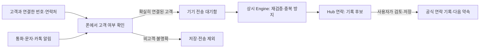

# 앱·모바일 핵심 UI와 고객 연락 연계 조사

> 2026-10-13 · 조사·권장안. 구현 승인 스펙이 아니다.
> 근거: 로컬 체크아웃 `10.bigmac2.2`, HEAD `7c86a1b6`의 소스·운영 문서와 플랫폼 공식 문서. 운영 배포·설치 APK·실기기 성능은 이번에 검증하지 않았다.
> 운영자 요청: 앱·모바일을 더 빠르고 핵심만 보이게 만들 개발 요소 파악. 연락 연계 범위는 **주소록 + 통화·문자·카톡 기록 후보**, 대상은 **고객 연락처만**.

## 1. 결론

기존 Electron·Capacitor 앱과 Hub 원장을 유지하면서, 모바일의 진입 구조와 첫 요청을 작게 만드는 접근을 권장한다. 모바일은 `오늘 / 연락 / 더보기`를 기본 탐색으로 두고 어디서든 같은 빠른 입력을 연다. 복잡한 제작·분석·설정은 상세 화면으로 이어진다.

연락 연계는 고객별로 연결한 휴대폰 연락처만 대상으로 삼는다. 전화·문자는 번호 기반으로 휴대폰에서 먼저 판별하고, 서버에서도 고객 범위를 다시 검사한다. 카톡의 표시 이름만으로는 상대를 확정할 수 없으므로 자동화 범위가 더 좁다. 수신 알림에서 고객을 신뢰성 있게 식별할 수 없는 경우에는 고객을 지정해 공유하는 경로를 쓴다.

## 2. 현재 만들어진 것과 빈틈

| 영역 | 소스에서 확인한 현재 상태 | 개발 요소 |
|---|---|---|
| 데스크톱 | Electron 원격 Hub + 빠른 입력 위젯 + 펫 | 전체 허브와 빠른 패널의 역할을 구분하고 고객·업무 상세로 직접 연결 |
| Android | Capacitor 8 원격 Hub, 공유 Intent, App Links, 런처 바로가기, 연결 실패 화면 | 모바일 전용 탐색·작은 읽기·고객 연락처 네이티브 연결 |
| iOS | `apps`에 별도 iOS 앱 패키지 없음 | 현재 조사·1차 개발은 문서상 운영 기기인 갤럭시 기준 |
| 모바일 탐색 | 900px 이하에서 기존 사이드바가 오버레이로 바뀜 | 10개 주요 앵커를 폰에서도 탐색하는 대신 핵심 진입을 앞에 배치 |
| 속도 | 페이지 동적 로딩, 유휴 시 6페이지 prefetch, 절약 모드/느린 연결 예외, daily-brief 요청 합치기와 메모리 캐시 | 이미 있는 최적화를 재개발하지 않고 첫 응답의 서버 읽기 범위를 축소 |
| 홈·오늘 | 서로 다른 화면. 오늘에는 입력·할 일·고객·일정 외 보고·추천·지표도 있음 | 모바일 첫 화면에서는 빠른 입력·첫 행동·다음 일정이 위에 남도록 재구성 |
| 보조 정보 | `MoreDetail`은 열었을 때만 자식이 마운트됨 | 이 부분은 이미 지연 마운트됨. 다만 상위 daily-brief API는 보조 원장도 읽음 |
| 캘린더 | `viewMode` 기본값은 `week` | 폰에서는 날짜별 일정 목록을 기본으로 제공 |
| 연락처 가져오기 | 새 고객 창에 `navigator.contacts.select(['name','tel'], {multiple:false})` | 한 명·첫 번호 가져오기이며 지속 동기화가 아님. 복수 번호 선택·기존 고객 연결·오류 안내 필요 |
| Android 연락처 | Manifest에 연락처 권한·연락처 브리지·알림 리스너가 없음 | WebView의 웹 API 지원을 전제하지 않고 네이티브 선택 경로 추가 |
| 연락 사건 | Engine 수신·고객 대조·중복 방지·Hub 기록 후보·확인 후 기록 경로 있음 | 휴대폰에서 고객만 선별, 영속 전송함, 운영 연결과 실기 검증 필요 |
| 오프라인 | Android는 실패 화면과 재시도 제공 | 빠른 입력·연락 사건의 영속 전송함은 별도 개발. 연결 복구 화면과 오프라인 저장은 다른 기능 |

소스 근거:
- [Android 안내](../../apps/android/README.md), [실제 Hub 주소](../../apps/android/app.config.json), [Manifest](../../apps/android/android/app/src/main/AndroidManifest.xml), [MainActivity](../../apps/android/android/app/src/main/java/app/moonlight/hub/MainActivity.java)
- [데스크톱 안내](../../apps/desktop/README.md), [앱 셸·prefetch](../../apps/hub/components/hub/hub-app.jsx), [공유 읽기 캐시](../../apps/hub/components/hub/daily-brief-signals.js)
- [오늘 화면](../../apps/hub/components/hub/pages/daily-brief.jsx), [집계 API](../../apps/hub/app/api/hub/daily-brief/route.js), [캘린더](../../apps/hub/components/hub/pages/work.jsx), [고객 창](../../apps/hub/components/hub/pages/customers.jsx)

## 3. 권장 UI 구조

모바일 첫 화면의 정보 예산은 다음처럼 잡는다. 이는 새 제안이며 기존 홈 배치 확정안을 자동 대체하지 않는다.

| 위치 | 보이는 것 | 행동 |
|---|---|---|
| 상단 | 날짜·현재 소속, 검색 | 회사/개인 전환·고객/업무 검색 |
| 첫 입력 | 짧은 한 줄 입력 | 할 일 또는 정리 전 저장 |
| 핵심 본문 | 지금 할 행동 한 건과 이유·기한 | 완료, 연락, 해당 업무 열기 중 문맥에 맞는 주 행동 하나 |
| 다음 줄 | 다음 일정 한 건 | 일정 목록 열기 |
| 보조 진입 | 오늘 남은 일·연락 후보의 작은 요약 | 해당 목록으로 이동 |
| 하단 탐색 | 오늘 · 연락 · 더보기 | 빠른 입력은 동일 창으로 연결하고 키보드가 열리면 입력/저장을 우선 |

- `연락`: 오늘 연락할 고객과 미처리 기록 후보를 구분. 고객 행은 **이름 / 연락할 이유 / 다음 약속 / 주 행동**만. 거래 금액·전체 이력은 상세.
- 연락 결과: 고객·채널·시각을 미리 채우고, 요약·반응·다음 행동/날짜를 기존 공용 기록창에서 확인. 저장됐다는 서버 응답 뒤 후보를 닫는다.
- 캘린더: 일정 목록 → 필요할 때 주/월 보기. 고객 기록: 모바일 전체 높이 시트와 키보드 위 저장 접근을 기존 Drawer 계약으로 유지.
- 데스크톱: 전체 운영 허브 유지. 위젯·펫은 입력/첫 행동을 빠르게 처리하고 같은 고객·할 일 상세로 돌아오는 진입점. Mac·Windows의 플랫폼별 UI 계약은 유지한다.
- 프로젝트·제품·브랜드·콘텐츠·매출 분석은 더보기/검색에서 접근. 첫 화면에 패널을 추가해 해결하지 않는다.

390×844에서 입력과 첫 행동을 스크롤 없이 식별할 수 있어야 한다. 44px 터치·16px 입력·기존 토큰/프리미티브를 적용한다. 기존 홈·오늘을 하나로 합칠지, 모바일에서만 앞단을 줄일지는 별도 설계 결정이며, 이번 권장은 후자다.

## 4. 속도 개선 우선순위

1. **첫 응답 범위 축소.** 현재 daily-brief는 attention·work·content·automations·work-orders·counts·morning-brief의 7개 최상위 읽기를 기다린다. 각 내부 읽기와 이후 check-item 문맥도 있어 실제 DB 요청 수는 이보다 많을 수 있다. 모바일에서는 오늘 할 일·집중 고객·다음 일정의 얇은 읽기를 먼저 완료하고 나머지는 필요할 때 읽는다. 우선순위 규칙과 원장은 기존 것을 재사용한다.
2. **반복 조회 중복 확인.** 홈 일정 읽기와 attention 내부 일정 읽기는 목적·기간이 다르다. 실제 네트워크 측정 후 겹치는 범위를 재사용한다. 저장 후에는 기존 tasks 부분 갱신처럼 바뀐 영역만 다시 읽는다.
3. **모바일 prefetch 예산.** 현재는 느린 연결 외에는 6개 업무 페이지를 유휴 시간에 가져온다. 폰에서는 오늘·연락 우선으로 좁힐 효과를 측정한다. `ssr:false` 필수 계약을 유지한다.
4. **일관된 캐시 표시.** 현재 캐시는 같은 JS 실행 문맥의 메모리 캐시이며 앱·창 사이 전체 공유나 디스크 오프라인 보관을 뜻하지 않는다. 지난 값을 보여줄 때 조회 시각/갱신 상태를 표시하고, 인증 만료 때 폐기한다.
5. **입력 보존.** 앱 종료·연결 끊김에도 초안과 재시도 ID를 보존한다. `기기에 보관`과 `Hub에 저장됨`을 구별한다. 빠르게 보이게 하려고 미확인 저장을 완료로 표시하지 않는다.

이번에는 병목을 실측하지 않았다. Android README의 첫 프레임 중앙값 780ms·첫 Hub paint 1688ms는 과거 에뮬레이터 기록이며 현재 휴대폰에서 업무가 조작 가능한 시점의 측정치가 아니다.

검증 목표: 첫 행동 이해 5초·메모 저장 10초·연락 결과 기록 20초(기존 심화 설계 목표). 기술 측정은 콜드/웜 시작, 입력 가능 시점, 첫 행동 데이터 표시, 탭 전환, 서버 저장 확인의 중앙값·p95를 실기에서 구분한다. 미연결 상태를 0건으로 표시하지 않는다.

## 5. 고객 연락처만 연결하는 방법

### 권장: 고객별 네이티브 연락처 연결 + 단방향 갱신

`Moonlight 고객 선택 → 휴대폰 연락처 연결 → 사용할 번호 선택 → 연결한 정보만 갱신`

- 고객 레코드와 기기 연락처 식별자·선택 번호를 매핑한다. 이름만으로 자동 병합하지 않는다. 번호 변경 시에는 기존 연결 식별자로 변경을 제안한다.
- 연락처 연결과 신규 고객 생성은 별개다. 주소록에 있다는 이유로 리드·거래·할 일을 자동 생성하지 않는다.
- 처음에는 폰→Moonlight의 이름·전화·선택 이메일 변경만 제안하고, CRM 요약·거래·약속은 그대로 둔다. 삭제·충돌은 검토로 넘기며 양방향 덮어쓰기는 후속 범위다.
- 선택 가져오기는 시스템 Picker를 사용한다. Android 17의 새 Picker와 이전 Android의 `ACTION_PICK`을 기기 버전에 맞춰 검토한다. 선택 후 지속 변경 읽기에 필요한 권한과 URI 수명은 별개이므로 Picker만으로 자동 동기화된다고 약속하지 않는다. [Android Picker](https://developer.android.com/about/versions/17/features/contact-picker?hl=en), [Contacts Provider](https://developer.android.com/identity/providers/contacts-provider)
- 지속 읽기가 필요하면 Contacts Provider와 권한을 연결하되, 앱의 조회·저장·전송 범위는 연결 고객으로 제한한다. OS 권한 자체가 고객별로 제한되는 것은 아니다.

### 대안 비교

| 방식 | 이점 | 한계·적합성 |
|---|---|---|
| 웹 Contact Picker | 현재 코드 재사용, 사용자가 선택한 정보만 받음 | 매번 선택하는 가져오기. 지속 접근 권한이 없고 APK WebView 지원은 별도 확인 필요 |
| Android 네이티브 연결 | 기기 주소록과 고객만 연결하고 사건을 폰에서 거를 수 있음 | 브리지·권한·변경 감지·전송함 개발 필요. 이번 요청에 가장 잘 맞음 |
| Google People API | Google 연락처를 서버에서 주기적으로 갱신 가능 | 폰/SIM/삼성/타 계정 전용 연락처는 그대로 포함되지 않음. 기본 connections 읽기는 전체 Google 연락처이므로 고객만 최소 접근하려는 요구에는 선택 범위 설계가 추가로 필요 |

웹 Picker는 선택형이며 권한이 지속되지 않는다. [Chrome 공식 문서](https://developer.chrome.com/docs/capabilities/web-apis/contact-picker)

People API는 `contacts.readonly` 별도 동의가 필요하다. 현재 Calendar 권한으로 대체되지 않는다. 증분 syncToken은 전체 동기화 후 7일 만료하며, 삭제·페이지네이션·재동기화 처리가 필요하다. 기기 전용 연락처와 Google 연락처는 구분된다. [People API](https://developers.google.com/people/api/rest/v1/people.connections/list), [Google 연락처 동기화](https://support.google.com/phoneapp/answer/9423168?hl=en-TD)

## 6. 고객 통화·문자·카톡 기록 후보

| 채널 | 후보에 필요한 최소 정보 | 현실적인 범위 |
|---|---|---|
| 통화 | 고객, 시각, 방향, 통화 시간 | MacroDroid 수집 경로와 서버 코드 있음. 번호/시간 제공·권한·절전 조건은 Galaxy 실기 검증 필요. 녹음·대화 요약 포함 안 함 |
| 문자 | 고객, 시각, 수신 방향, 제한된 미리보기 | 현재 가이드는 SMS 수신 기준. 발신·MMS·RCS 전체 이력까지 연결됐다는 뜻은 아님 |
| 카톡 | 고객 연결 근거, 시각, 수신 미리보기 | 알림에 노출된 정보만. 내가 보낸 메시지·과거 대화 전체·알림 미발생 상황은 이 경로로 수집 불가 |

카카오 공개 메시지 API는 메시지 발송을 지원하며 개인 대화 전체를 읽는 동기화 API로 사용할 수 없다. Android NotificationListener는 실제 올라온 알림을 받는 인터페이스다. [Kakao 메시지 API](https://developers.kakao.com/docs/ko/kakaotalk-message/rest-api), [Android 알림 리스너](https://developer.android.com/reference/android/service/notification/NotificationListenerService)

**고객만이라는 조건의 핵심:** 알림 접근 권한은 고객별로 주어지지 않는다. OS가 넓게 전달한 알림에서 발신 식별 정보를 잠깐 확인해야 필터할 수 있다. 비고객 본문을 전송 대기함·파일·디버그 로그·서버에 남기지 않는 것이 구현 계약이다. 비고객 알림이 프로세스에 아예 전달되지 않아야 한다면 이 자동 수집 방식은 충족하지 못하므로 수동 공유를 쓴다.

카톡 알림에는 전화번호/고유 발신 식별자가 없을 수 있다. 동명이인·단체방·표시 이름 변경 때문에 이름 일치만으로 고객이라고 확정하지 않는다. 고객의 1:1 대화 연결을 검토하되, 실기에서 안정적인 식별 근거를 확보하지 못하면 **고객을 지정한 공유/붙여넣기만** 허용한다. 자동 후보와 기록 누락 가능성을 UI에서 분리해 설명한다.

### 기존 코드에서 반드시 보완할 점

- 현재 `handlePhoneEventIntake`는 사건 본문을 받은 뒤 고객 디렉터리를 대조한다. 비고객을 DB에 남기지 않아도 원문이 서버까지 전송되는 구조다. **폰 선필터**를 추가하고 서버에서도 범위 위반을 거절한다.
- 요청의 `captureUnmatched/newLead/isNewLead`로 미등록 번호 후보를 허용하는 경로가 있다. 이번 고객 전용 범위에서는 클라이언트 OFF만으로 끝내지 말고 서버의 고객 전용 정책으로도 비활성화한다.
- 현재 매칭은 `contacts/leads/accounts/companies`를 조합하고 연락처만 있는 사람도 포함될 수 있다. 단순 DB 존재와 운영자가 지정한 고객 범위를 동일시하지 말고, 명시적 연결/수집 대상 상태를 둔다.
- `meta.kakao_names`는 기존 이름 매칭 자산이지만 발신자 신원을 증명하는 값이 아니다. 별칭 관리 UI와 애매한 매칭 제외가 필요하다.
- 전송함에는 이미 고객으로 선별된 최소 정보만 보관한다. 발생 시각·이벤트 ID를 고정하고 재전송 시 같은 요청으로 처리한다. 서버의 현재 결정론적 중복 키와 이행 호환성을 유지한다.
- `saved/duplicate/ignored`와 인증 오류·일시 장애를 구별한다. 권한 해제·로그아웃·고객 연결 해제 시 신규 수집을 멈추고 아직 보내지 않은 해당 고객 사건도 제외한다.
- 현재 7일 지난 원문 정리는 성공한 intake 뒤 실행된다. 유입이 끊겨도 보존 기간이 지켜지도록 독립 정리 경로가 필요하다. 후보의 2일 목록 노출 제한과 7일 정리는 다른 규칙이며 지연 도착 사건 표시도 검증한다.
- MacroDroid로 먼저 검증할 수 있지만 고객 목록 갱신·선필터·영속 큐를 안정적으로 유지하지 못하면 Capacitor 네이티브 모듈로 옮긴다. WorkManager는 재부팅을 넘어 작업을 예약·재시도할 수 있지만 정확한 즉시 실행을 보장하는 장치는 아니다. [WorkManager](https://developer.android.com/develop/background-work/background-tasks/persistent)

근거: [수신 처리](../../apps/engine/lib/phone-capture-http.ts), [매칭·중복 키](../../apps/engine/lib/phone-capture.ts), [저장·보존 정리](../../apps/engine/lib/phone-capture-store.ts), [후보 API](../../apps/hub/app/api/hub/record-candidates/route.js).

## 7. 개발 순서와 검증

1. **기준선:** 현재 설치 APK/Hub 버전, Galaxy/One UI 버전, 콜드·웜 시작과 주요 3동작 시간을 확인한다. 고객 번호·복수 번호·카톡 표시 정보의 실제 식별 가능성을 검증한다.
2. **핵심 UI:** 모바일 오늘·연락·더보기와 공용 빠른 입력, 목록형 일정, 첫 화면용 작은 읽기를 설계·검증한다.
3. **고객 연결:** 고객별 연락처 매핑·선택 번호·변경 검토·연결 해제, 고객 전용 수집 정책을 만든다.
4. **통화·문자:** 고객 선필터 → 영속 전송 → 상시 Engine → 기록 후보 → 확인 후 공식 기록을 끝까지 닫는다.
5. **카톡:** 식별 근거·누락 상황을 먼저 실측한다. 검증된 범위만 자동 후보화하고 나머지는 고객 지정 공유로 처리한다.

통과 조건: 비고객 원문의 전송/저장 0, 같은 사건 재시도에 중복 기록 0, 저장 확인 없는 성공 표시 0. 오프라인·앱 종료·재부팅·로그인 만료·권한 해제·고객 해제·동명이인·대표번호 공유·알림 묶음/갱신·단체방을 포함한다. 실제로 발생하지 않은 알림까지 누락 0이라고 주장하지 않는다.

## 8. 문서 상태와 남은 확인

- 9/26 갤럭시 브리프의 `PWA 우선`은 DRAFT다. 지금은 실제 Capacitor Android 셸이 있으므로 그것을 활용하는 권장안이다.
- Android README의 주소 placeholder 설명과 실제 `app.config.json`은 다르다. 실제 값은 운영 Hub 주소다.
- 예전 Galaxy 가이드의 Mac/Tailscale·텔레그램 버퍼 제안은 현재 상시 Hub/Engine·후속 설계와 충돌한다. 폰 연결에서는 상시 Engine의 실제 설정을 확인하고 직접 Supabase service-role을 넣지 않는다.
- 기존 웹 Picker 오류는 취소와 실제 실패를 함께 무시한다. 사용자에게 지원 여부·권한·실패와 수동 입력 대안을 구분해 보여줄 필요가 있다.
- 공식 정보 갱신·로컬 소스 조사는 완료했다. UI 스크린샷 감사, 실기기 측정, 주소록/알림 읽기, 운영 DB 접근, 코드 변경·배포는 하지 않았다.
- 사용자 확인 완료: 고객 연락처만, 주소록과 통화·문자·카톡 기록 후보까지. 기종/OS, 주소록의 저장 계정, 카톡 알림의 식별 가능성은 실기 확인 사항으로 남긴다.
